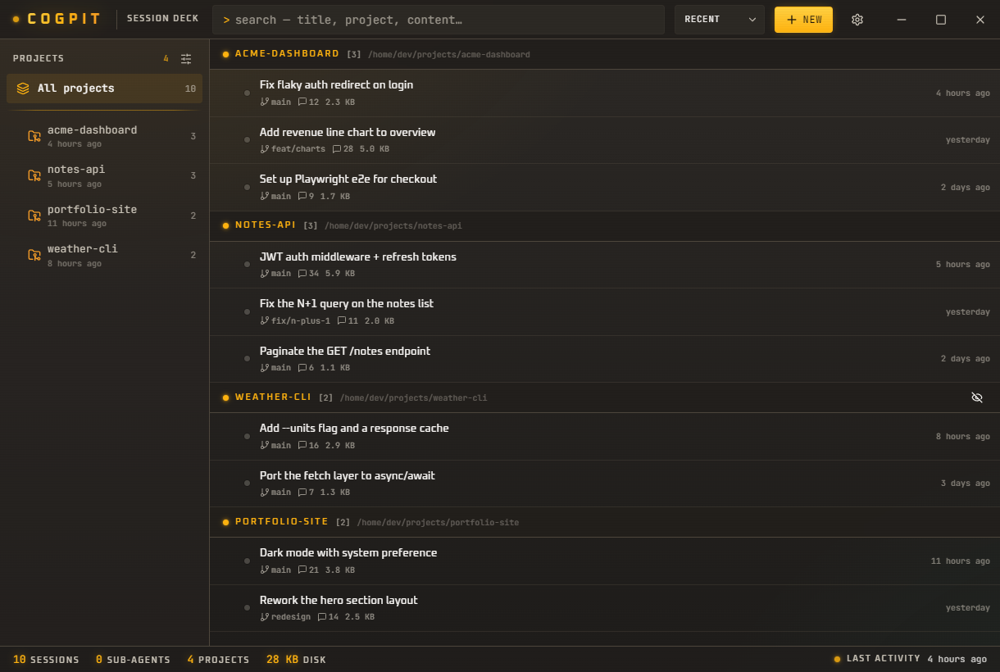
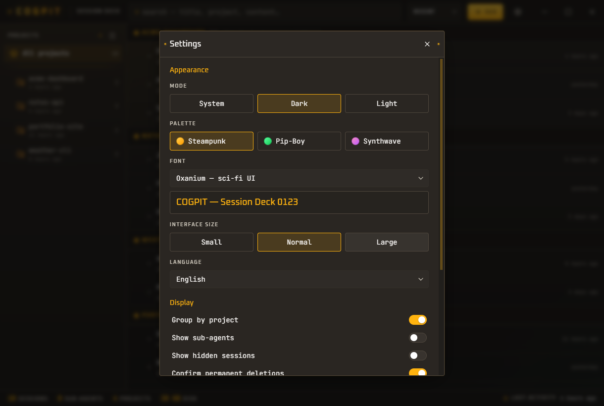

<div align="center">

# ⚙️ Cogpit

**A cockpit for your Claude Code sessions.**

Browse, resume and clean up every Claude Code CLI conversation from one window —
so closing your editor or rebooting never means hunting for a lost console again.




<sub>Shown with placeholder sessions. The UI ships in English and French and follows your device language (switchable in Settings).</sub>

</div>

---

## Why

Claude Code stores every session as a `.jsonl` file under `~/.claude/projects/`.
Great for the CLI, invisible for you: once a terminal is closed there is no list,
no search, no "reopen that debugging session from Tuesday". Cogpit reads that store
and turns it into a browsable, searchable, resumable library — then lets you run
several sessions side by side without juggling terminal windows.

## Features

- **Every session in one place** — grouped into a project tree, resolved from each
  session's real `cwd` (not the lossy encoded folder name, so sessions Claude filed
  under two different folders are merged), or a flat sortable list.
- **Meaningful titles** — uses Claude's own `aiTitle`, then the session summary, then
  the first prompt.
- **Full-text search** across titles, projects, branches **and the whole conversation
  content** (indexed on scan, in the main process — never shipped to the UI).
- **Resume in a click** — an integrated terminal (xterm + a prebuilt pty, no toolchain
  needed) with an automatic fallback that opens your native terminal in the right folder.
- **Run sessions in parallel** — resumed and new sessions open as tabs in a resizable
  bottom dock; their ptys stay alive when you switch tabs, so you can pilot several
  conversations at once. Running sessions are pinned to the top of the list.
- **New session** in any known project — opens straight into an integrated terminal.
- **Open in your editor** — jump to a project in Cursor or VS Code in one click.
- **Reversible trash** — sessions move to Cogpit's own trash and can be restored;
  permanent deletion is a separate, explicit action.
- **Rename / pin / favourite / hide** — right-click a session or project. All of it is
  stored in Cogpit's own metadata file, so your live `.jsonl` files are **never modified**.
- **Live refresh** — the list updates as you work in the CLI (folder watcher).
- **Discreet stats** + per-session details (messages, size, branch, version, dates).
- **System tray** — closing the window keeps Cogpit humming in the tray.

## Appearance

Cogpit is themed as an **amber-phosphor flight deck**: amber on near-black with
AA/AAA contrast as the hard rule, plus CRT scanlines, a boot sequence, status LEDs and
a phosphor glow — readable first, characterful second. A frameless window with its own
title bar keeps the chrome on-theme. Everything below is switchable in **Settings →
Appearance**:

- **3 palettes** — Steampunk (amber), Pip-Boy (green) and Synthwave (pink/violet).
- **Display fonts** — Oxanium by default, plus Orbitron, Chakra Petch, Press Start 2P
  and VT323 (all embedded as OFL woff2 — no network fetch). Data and the terminal use
  JetBrains Mono.
- **UI scale** — small / medium / large.
- **Language** — English or French, auto-detected from your device (override in Settings).
- **Light / dark** — follows the OS, fully overridable.

<div align="center">

</div>

## Getting started

Uses [pnpm](https://pnpm.io/).

```bash
pnpm install         # install dependencies
pnpm start           # launch in development (hot reload)
```

Build & package:

```bash
pnpm build           # bundle main + preload + renderer
pnpm typecheck       # type-check both tsconfigs (esbuild doesn't)
pnpm dist:win        # build a Windows installer (also: dist:linux)
```

### Integrated terminal

The in-app terminal uses [`@homebridge/node-pty-prebuilt-multiarch`](https://github.com/homebridge/node-pty-prebuilt-multiarch),
a drop-in `node-pty` fork that ships **N-API prebuilt binaries** — so it works out of
the box, with **no C++ toolchain and no rebuild**, on common platforms. Copy and paste
work via the system clipboard (right-click, or `Ctrl+Shift+C` / `Ctrl+Shift+V`).

If the prebuilt can't load on your platform, run:

```bash
pnpm setup:terminal  # detects & installs build prerequisites, then rebuilds from source
```

And if even that isn't possible, **nothing breaks**: Cogpit falls back to launching your
system terminal (Windows Terminal / PowerShell / Terminal.app / your Linux emulator) in
the session's working directory, with a copy-the-command button. Switch modes anytime in
**Settings → Terminal**.

## How it works

```
~/.claude/projects/<encoded-cwd>/<session-id>.jsonl   ← Claude Code's store (read-only to us)
            │
   adapters/claudeCode  ─ streams each file, distils metadata (title, cwd, branch, dates…)
            │
   lib/sessions  ─ scan + per-file cache (mtime+size) so rescans are instant
            │
   IPC (preload bridge)  ─ typed contract in src/shared/types.ts
            │
   React UI  ─ list, search, preview, terminal dock, trash
```

- **Adapters.** Everything Claude-Code-specific lives behind `SessionAdapter`
  (`src/main/adapters/`). Supporting another agent CLI later means adding one adapter,
  not rewriting the app.
- **We never touch your sessions.** Renames, pins, favourites, hidden flags and the
  trash all live in Cogpit's `userData` folder. The only writes to `~/.claude` are the
  deletions you explicitly ask for.
- **CommonJS main/preload, ESM renderer.** Keeps the native pty and Electron internals
  out of ESM-interop trouble while the UI stays modern.

## Privacy

Cogpit is fully local. It reads `~/.claude` **at runtime** on your machine and sends
nothing anywhere. No telemetry, no network calls. None of your session data is part of
this repository (`.jsonl` files are git-ignored).

## Roadmap

- "Launch at startup" toggle
- Export / archive a conversation to Markdown
- Additional CLI adapters

## License

MIT © Alexandre Da Costa
